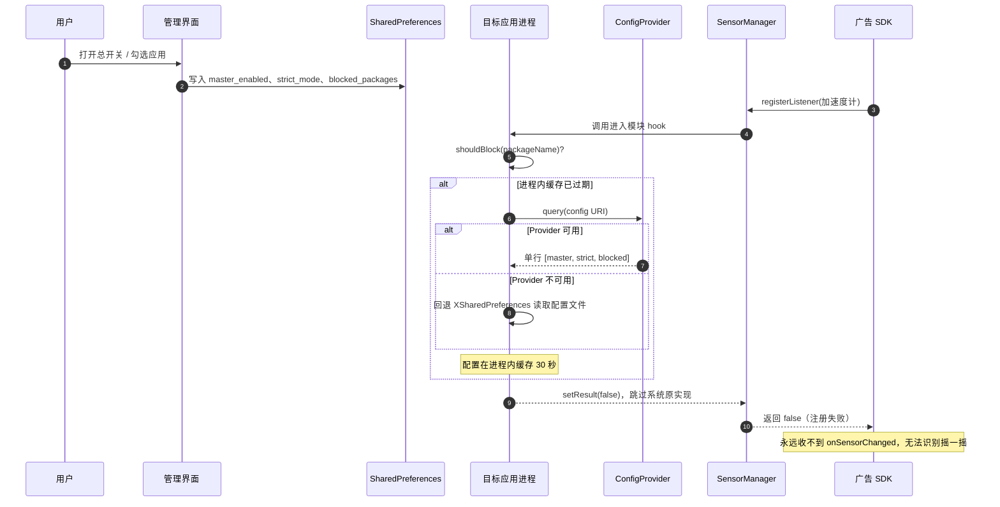
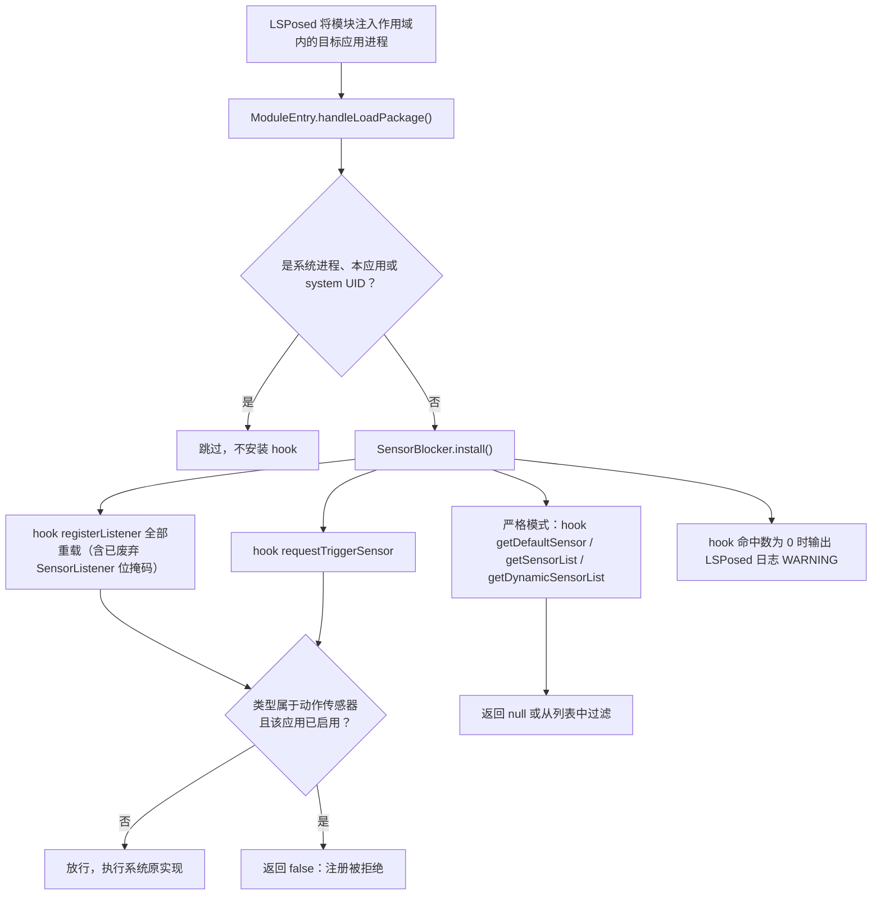

# 摇一摇克星（NoShake）

[](https://github.com/liuyunyang928/1/actions/workflows/build.yml)
[](LICENSE)
[](https://developer.android.com)
[](https://github.com/LSPosed/LSPosed)
[](https://github.com/liuyunyang928/1)

> 从源头掐掉「摇一摇」跳转广告：按应用拒绝加速度计、陀螺仪等动作传感器的注册，让广告 SDK 一次抖动数据都收不到。

**摇一摇克星（NoShake）是一个 Android LSPosed 模块 + 管理界面。v1 仅支持已 root（Magisk / KernelSU）并安装 LSPosed 的设备；没有 root 的设备无法使用。**

---

## 目录

- [特性](#特性)
- [背景：为什么摇一摇广告拦不住](#背景为什么摇一摇广告拦不住)
- [工作原理](#工作原理)
- [环境要求](#环境要求)
- [安装与使用](#安装与使用)
- [配置与生效说明](#配置与生效说明)
- [管理界面](#管理界面)
- [FAQ](#faq)
- [已知限制](#已知限制)
- [隐私声明](#隐私声明)
- [项目结构](#项目结构)
- [构建](#构建)
- [路线图](#路线图)
- [贡献](#贡献)
- [致谢与参考链接](#致谢与参考链接)
- [License](#license)

## 特性

- **按应用拦截**：只对 LSPosed 作用域内、且在管理界面中被勾选的应用生效，其他应用不受影响。
- **从数据源头拦截**：在目标应用进程内 hook `SensorManager.registerListener(...)`（4 个 `SensorEventListener` 重载 + 2 个已废弃的 `SensorListener` 位掩码重载）与 `requestTriggerSensor(...)`，命中动作传感器时直接返回 `false`。广告 SDK 连传感器都注册不上，收不到任何一次事件，自然无法判断「摇一摇」。
- **最小拦截集合**：只拦与动作/方向直接相关的 9 种传感器（加速度计、陀螺仪、重力、线性加速度、旋转矢量、游戏旋转矢量、未校准陀螺仪、地磁旋转矢量、未校准加速度计），不拦光线、距离、磁力、显著运动、计步等，避免「自动亮度失效 / 通话时无法贴耳熄屏 / 计步归零」这类副作用。
- **可选的严格模式（实验性）**：额外让 `getDefaultSensor()` 返回 `null`、从 `getSensorList()` / `getDynamicSensorList()` 中隐藏动作传感器，默认关闭，可在管理界面开启；个别不做空判断的应用可能异常（见 [FAQ](#faq)）。
- **不伪造数据、不碰私有 API**：只 hook 公开方法，不读取/修改框架私有字段与 `@hide` 类，跨 Android 版本更稳定。
- **零权限、零联网**：App 未声明任何 `uses-permission`（包括网络权限），不收集、不上传任何数据。
- **配置快速生效**：修改配置后最多 30 秒内对新的传感器注册生效；首次把应用纳入拦截时需强制停止目标应用（hook 只在进程启动时装载）。
- **失败兜底（fail-closed）**：两条配置读取通道都不可用时按「已启用拦截」处理，避免拦截悄悄失效。
- **可诊断**：hook 命中数为 0 时会在 LSPosed 日志输出 WARNING；首次拦截会输出 `NoShake: blocking motion sensors for <包名>`。
- **开源可审计**：MIT 协议，纯 Kotlin + Material3 + ViewBinding，无第三方 UI 库；GitHub Actions 自动构建 Debug APK。

## 背景：为什么摇一摇广告拦不住

「摇一摇」开屏/信息流广告的实现方式很朴素：广告 SDK 在宿主应用里注册 `SensorEventListener`，监听加速度计（常配合重力、陀螺仪、旋转矢量），检测到一次足够强的晃动就触发 deeplink 跳转。用户往往只是走路、上车、拿起手机，就被带到电商或浏览器页面。

真正麻烦的是**「按应用关掉它」在 Android 上没有现成开关**：

1. **读取运动传感器不需要任何运行时权限。** 加速度计、陀螺仪等传感器对第三方应用完全开放，安装即用；只有心率等 `BODY_SENSORS` 类传感器需要授权。参见 [Sensors overview](https://developer.android.com/develop/sensors-and-location/sensors/sensors_overview)。
2. **Android 的权限模型不允许「应用管应用」。** 普通第三方 App 无法拦截、过滤另一个 App 对硬件传感器的访问。
3. **系统隐私开关不覆盖运动传感器。** Android 12+ 的隐私面板与快捷设置开关只管理摄像头与麦克风（整机级）；Android 10 开发者选项里的「Sensors off」虽然能全局关掉所有传感器，但不分应用、副作用大。参见 [Android 12 行为变更](https://developer.android.com/about/versions/12/behavior-changes-all) 与 [AOSP Sensors off](https://source.android.com/docs/core/interaction/sensors/sensors-off)。
4. **AOSP 没有任何「运动传感器」AppOps。** 传感器相关 AppOps 只有 `body_sensors`、`activity_recognition` 等，没有加速度计/陀螺仪对应的 op，因此也不存在「用 shell 命令按应用关掉」的路径。
5. **国产 ROM 的「获取设备动作与方向」权限是厂商私有实现。** 部分定制系统（小米/澎湃、vivo OriginOS、OPPO ColorOS 等）在系统层提供了按应用限制动作传感器的能力，但这不是 AOSP 标准 API，第三方 App 无法调用，也不能指望所有机型都有。本项目**不依赖、不读取、不修改**该系统权限。

因此，只有把代码注入目标应用进程、在传感器注册这一层做拦截，才能实现真正的「按应用」屏蔽。LSPosed 正是提供这一能力的框架。

> 更详细的调研（AOSP 源码依据、`cmd sensor_privacy`、AppOps、ROM 私有权限、Shizuku 能力边界、方案对比）见 [docs/feasibility.md](docs/feasibility.md)。

## 工作原理

### 整体链路



### Hook 决策流程



### 拦截细节

- **入口**：`assets/xposed_init` 指向 `io.github.liuyunyang928.noshake.xposed.ModuleEntry`；`AndroidManifest.xml` 中声明 `xposedmodule=true`、`xposedminversion=82`、`xposedsharedprefs=true`。LSPosed 在作用域内每个应用进程启动时实例化入口类，并在主线程 `handleLoadPackage()` 中安装 hook（早于应用代码执行）。因此 **hook 只在进程启动时装载**。
- **跳过对象**：系统进程（`android`）、本 App 自身进程、UID 小于 `Process.FIRST_APPLICATION_UID` 的系统 UID 一律跳过，避免影响自动旋转等系统功能。
- **被拦截的方法**（`hookAllMethods`，覆盖所有重载）：
  - `SensorManager.registerListener(SensorEventListener, Sensor, ...)`：第二个参数是 `Sensor`，其类型命中拦截集且该应用已启用时，`setResult(false)` 并跳过系统实现；
  - `SensorManager.registerListener(SensorListener, int[, int])`（已废弃的位掩码 API）：掩码包含方向/加速度位时同样返回 `false`，堵住容易遗漏的绕过面；
  - `SensorManager.requestTriggerSensor(TriggerEventListener, Sensor)`：按 `Sensor` 类型判定（当前拦截集合不含 `TYPE_SIGNIFICANT_MOTION`，该入口实际放行）；
  - **严格模式**额外处理：`getDefaultSensor()` 返回 `null`；`getSensorList()`、`getDynamicSensorList()` 过滤掉动作传感器。
- **拦截的 9 种传感器类型**（`core/Contract.kt` 中的 `MOTION_SENSOR_TYPES`）：

  | 值 | 常量 | 说明 |
  | --- | --- | --- |
  | 1 | `TYPE_ACCELEROMETER` | 加速度计，摇一摇最常用 |
  | 4 | `TYPE_GYROSCOPE` | 陀螺仪 |
  | 9 | `TYPE_GRAVITY` | 重力 |
  | 10 | `TYPE_LINEAR_ACCELERATION` | 线性加速度 |
  | 11 | `TYPE_ROTATION_VECTOR` | 旋转矢量 |
  | 15 | `TYPE_GAME_ROTATION_VECTOR` | 游戏旋转矢量 |
  | 16 | `TYPE_GYROSCOPE_UNCALIBRATED` | 未校准陀螺仪 |
  | 20 | `TYPE_GEOMAGNETIC_ROTATION_VECTOR` | 地磁旋转矢量 |
  | 35 | `TYPE_ACCELEROMETER_UNCALIBRATED` | 未校准加速度计 |

  **不拦截**：光线（5）、距离（8）、磁力（2/14）、显著运动（17）、计步（18/19）、心率（21/31）、气压/温度/湿度、铰链角（36）、佩戴检测（34）等，因此系统自动亮度、通话息屏、系统级计步/活动识别、折叠屏形态等功能不受影响（详见 [已知限制](#已知限制)）。
- **诊断**：`installed-hook` 计数为 0 时输出 `NoShake: WARNING no SensorManager method could be hooked in <包名>`（用于发现 ROM 改名/魔改 `SensorManager` 的情况）；首次拦截输出 `NoShake: blocking motion sensors for <包名>`。

### 配置读取链路

管理界面把配置写入本 App 私有的 `SharedPreferences`（文件名 `noshake_config`，键：`master_enabled`、`strict_mode`、`blocked_packages`）。为让不同 UID 的被 hook 进程也能读到配置，采用「双通道」：

1. **写入**：`ConfigStore` 以 `Context.MODE_WORLD_READABLE` 打开 preferences。启用模块时 LSPosed 会拦截该模式、把文件变为被 hook 进程可读；未启用 LSPosed 时该调用抛 `SecurityException`，代码自动回退 `MODE_PRIVATE`（此时只能走下面的 Provider 通道）。
2. **主读取通道**：目标进程通过只读 `ContentProvider` 查询配置：
   - authority：`io.github.liuyunyang928.noshake.config`
   - URI：`content://io.github.liuyunyang928.noshake.config/config`
   - 单行游标三列：`[master, strict, blocked]`，其中 `blocked` 是以逗号分隔的包名列表（包名不含逗号，分隔安全）。
3. **兜底通道**：Provider 不可用时回退到 `XSharedPreferences`（`Manifest` 中 `xposedsharedprefs=true` 启用 LSPosed 的桥接）。
4. **双双失败时 fail-closed**：按「已启用拦截」处理（应用既然被用户放进 LSPosed 作用域，拦截就是预期行为）。

配置在目标进程内缓存 **30 秒**，因此修改配置后最多 30 秒内对**新的**传感器注册生效；已经建立的监听不会断开，需要重启/强制停止目标应用。

## 环境要求

| 项目 | 要求 |
| --- | --- |
| 系统版本 | Android 8.0（API 26）及以上（App 的 `minSdk`）；实际可用的系统版本还受 LSPosed 支持范围限制，通常需要 Android 8.1+，以 LSPosed 官方说明为准 |
| root | 需要。Magisk（启用 Zygisk）或 KernelSU（配合可用的 Zygisk 方案） |
| 框架 | LSPosed（Zygisk 版本）；模块声明 `xposedminversion = 82` 并启用 `xposedsharedprefs` |
| 目标应用 | 通过 Java 层 `SensorManager` 读取传感器的常规应用（绝大多数应用与主流广告 SDK 属于此类） |
| 构建环境 | JDK 17、Android SDK Platform 35；AGP 8.7.3 + Gradle 8.9 |

> 没有 root 的设备无法使用本项目。免 root 方案的调研结论见 [docs/feasibility.md](docs/feasibility.md)。

## 安装与使用

### 1. 下载 APK

从 [GitHub Releases](https://github.com/liuyunyang928/1/releases) 下载最新 APK；如果还没有 Release，可在 [Actions](https://github.com/liuyunyang928/1/actions/workflows/build.yml) 中打开最近一次成功的 **Build APK** 运行，下载 `NoShake-debug` artifact（zip，解压后得到 `app-debug.apk`）。

### 2. 安装并启用 LSPosed

按 [LSPosed 官方仓库](https://github.com/LSPosed/LSPosed) 的说明，在已 root 的设备上安装 LSPosed，并确认 LSPosed 管理器可以正常打开。

### 3. 安装本模块

像安装普通 APK 一样安装「摇一摇克星」。这个 APK 同时是**管理界面**和**LSPosed 模块**，不需要额外刷入任何模块包。

### 4. 在 LSPosed 中启用模块

打开 LSPosed 管理器 →「模块」→ 找到「摇一摇克星」→ 启用。按 LSPosed 的提示重启（不同版本可能提示重启设备或仅重启作用域应用，以实际提示为准）。

### 5. 勾选作用域（关键步骤）

LSPosed 管理器 →「模块」→「摇一摇克星」→「作用域」→ 勾选需要拦截的应用。

> **作用域是本模块生效的前提。** 没有勾进作用域的应用，模块不会注入，自然不会拦截。

### 6. 在管理界面中开启拦截

打开「摇一摇克星」：

1. 确认顶部状态卡片显示「已检测到 LSPosed」；
2. 打开「启用拦截」总开关；
3. 在应用列表中找到目标应用，打开其右侧开关（可以用搜索框按应用名/包名过滤，也可以切到「已启用」查看已选中的应用）。

### 7. 强制停止目标应用（首次必做）

在系统设置中强制停止目标应用，再重新打开。因为 **hook 只在目标进程启动时装载**：如果目标应用此前已经在运行，需要重启进程才能让模块生效。之后修改配置无需再重启，最多 30 秒内自动生效。

### 8. 验证

- 正常情况：目标应用摇一摇不再跳转；
- 排障：打开 LSPosed 管理器 →「日志」，若看到 `NoShake: blocking motion sensors for <包名>`，说明 hook 已生效（每个进程只记录一次，用于减少日志噪音）；
- 若看到 `NoShake: WARNING no SensorManager method could be hooked in <包名>`，说明该 ROM 改动了 `SensorManager`，模块无法安装 hook。

## 配置与生效说明

### 配置项

| 配置 | 存储键 | 默认值 | 说明 |
| --- | --- | --- | --- |
| 启用拦截（总开关） | `master_enabled` | 开启 | 关闭后模块放行全部传感器注册（严格模式也一并失效） |
| 严格模式 | `strict_mode` | 关闭 | 额外隐藏传感器列表，防止应用通过「探测传感器是否存在」绕过；由管理界面「严格模式（实验性）」开关控制 |
| 拦截应用列表 | `blocked_packages` | 空 | 以 `StringSet` 保存的包名集合，对应管理界面中打开的开关 |

有效判定：目标应用在 `blocked_packages` 中，且总开关开启，才会拦截；严格模式同样要求总开关开启。

### 生效时机

| 场景 | 生效时间 |
| --- | --- |
| 修改配置后，目标应用**新注册**传感器 | 最多 30 秒内（目标进程内的配置缓存 TTL） |
| 首次把某应用纳入拦截（目标应用已在运行） | 需强制停止并重新打开目标应用（hook 只在进程启动时装载） |
| 首次启用模块 / 修改 LSPosed 作用域 | 按 LSPosed 提示重启；必要时强制停止目标应用，无需重启整个设备 |
| 目标应用已有监听 | 不会断开；需强制停止/重启目标应用 |
| 目标应用进程重启 | 启动时立即读取最新配置 |
| 关闭总开关 | 同上：对新注册立即放行，已有监听需重启应用 |

> 经验做法：勾选或取消应用后，顺手在系统设置里强制停止目标应用，避免等待缓存过期。

## 管理界面

管理界面是一个轻量 Material3 页面（单 Activity + RecyclerView），不申请任何权限：

- **顶栏菜单**：使用说明、GitHub 仓库、关于（版本号 / 开源协议 / 隐私说明）；
- **状态卡片**：总开关、已启用应用数量、严格模式开关（标题「严格模式（实验性）」，副标题提示「同时让应用认为动作传感器不存在。个别未做空判断的应用可能崩溃，遇到异常请关闭。」）、LSPosed 是否安装（未安装时高亮提示），以及「打开 LSPosed」按钮；
- **搜索**：按应用名或包名实时过滤（忽略大小写）；
- **筛选**：「全部 / 已启用」；
- **应用列表**：图标、名称、包名、Material3 开关；已启用的应用置顶，其余按中文排序；本 App 自身不显示；
- **状态处理**：加载中显示进度条，无数据/无匹配结果显示对应空态；应用列表加载失败给出提示。

## FAQ

### 勾选后摇一摇仍然跳转，怎么排查？

按以下顺序检查（前两条最常见）：

1. **LSPosed 作用域是否勾选了目标应用？** 只在管理界面打开开关是不够的，必须在 LSPosed 中把目标应用勾进本模块的作用域。
2. **模块是否已启用、是否重启过？** LSPosed 中启用模块后需要按提示重启。
3. 管理界面的「启用拦截」总开关和目标应用开关是否都处于开启状态？
4. 首次启用后，是否强制停止过目标应用？（hook 只在进程启动时装载）
5. 是否已经等待超过 30 秒？（配置缓存 TTL）
6. 目标应用是否属于系统应用 / 系统 UID？这类进程会被模块主动跳过。
7. 跳转是否根本不是摇一摇触发的（例如点击广告、自动倒计时跳转、deeplink）？这类行为不在本模块处理范围。
8. 目标应用是否通过 NDK 或 WebView 读取传感器？Java 层 hook 对 NDK `ASensorManager` 和 WebView 的 `devicemotion`/`deviceorientation` 事件无效。
9. 打开 LSPosed 日志：
   - 看到 `NoShake: blocking motion sensors for <包名>` → hook 已生效，问题可能出在覆盖范围（第 7、8 条）；
   - 看到 `WARNING no SensorManager method could be hooked` → 该 ROM 改动了 `SensorManager`，当前版本无法拦截；
   - 完全没有 NoShake 日志 → 模块没有注入到该进程（回到第 1、2 条）。
10. 如果开启了严格模式，个别应用可能因拿不到传感器而崩溃或走异常分支，请先关闭严格模式再测。

### 会不会耗电、会不会常驻后台？

不会常驻。模块代码只在被勾选的目标应用进程内运行，没有后台服务、没有定时轮询、没有网络请求；配置读取在传感器注册调用时触发，最多每 30 秒一次。被拦截的注册根本不会调用系统实现，因此也不会产生传感器采样开销。管理界面本身也不在后台运行。

### 安全吗？会泄露隐私吗？

- 本 App 未声明任何权限（包括 `INTERNET`），没有网络能力，也没有统计/广告/第三方 SDK；
- 配置只保存在本机的 `SharedPreferences` 中；
- 为了让被 hook 进程读取配置，preferences 以 `MODE_WORLD_READABLE` 打开（仅在 LSPosed 启用时由框架接管为可读；未启用时回退私有模式）；
- 为了跨 UID 传配置，App 导出了一个**只读** `ContentProvider`，任何应用都可以查询到「总开关、严格模式、被拦截的包名列表」——这是机制的必要条件，内容不包含个人信息；
- 代码开源（MIT），可自行审计或从源码构建。作为 root 框架模块，请只使用来自本仓库的构建产物，并自行评估第三方修改版的风险。

### 和国产 ROM 自带的「获取设备动作与方向」权限什么关系？

那是部分厂商在系统层自行实现的按应用权限（小米/澎湃、vivo OriginOS、OPPO ColorOS 等均有，名称与入口各异），属于私有实现，底层实现没有公开标准。本 App **不依赖、不读取、不修改**它：

- 你的系统如果有这个权限，可以直接用系统设置解决部分应用，未必要装本模块；
- 没有该权限的机型（或应用不受该系统权限约束）才是本模块的用武之地；
- 两者可以同时存在，不冲突。

### 和 GKD 等无障碍方案有什么区别？

| | 摇一摇克星（NoShake） | GKD 等无障碍方案 |
| --- | --- | --- |
| 原理 | 在目标进程内拒绝传感器注册 | 通过无障碍服务识别并处理界面跳转 |
| 时机 | **事前**：广告 SDK 拿不到传感器数据 | **事后**：跳转/广告页已经出现 |
| 权限 | root + LSPosed | 无障碍服务（免 root） |
| 覆盖 | 只作用于已勾选、且在 LSPosed 作用域内的应用 | 覆盖界面层可观察到的行为 |

两者互补：一个从数据源头掐掉摇一摇，一个处理界面上的骚扰。本项目暂未与 GKD 做联动。

### 没有 root 能用吗？

不能。v1 只支持 root + LSPosed。原因：AOSP 没有「按应用禁用运动传感器」的 API / AppOps，普通应用无权拦截其他应用的传感器访问；Shizuku 等免 root 方案也无法绕过这一点（免 root 的唯一可行空间是「已适配的国产 ROM 私有权限」）。详见 [docs/feasibility.md](docs/feasibility.md)。

### 为什么直接拒绝注册，而不是伪造传感器数据？

拒绝注册更简单、更稳定：不触碰框架私有字段，不需要模拟不同传感器的数据格式与时序，跨 Android 版本更不容易失效。代价是应用可能感知到「这个传感器不可用」（例如传感器列表里看不到）。伪造数据在[路线图](#路线图)中。

### 严格模式现在能用吗？

可以。严格模式默认关闭，在管理界面状态卡片中打开「严格模式（实验性）」开关即可。开启后会额外让 `getDefaultSensor()` 返回 `null`、从 `getSensorList()` / `getDynamicSensorList()` 中隐藏动作传感器，防止应用通过「探测传感器是否存在」绕过。

风险：个别应用不做 `getDefaultSensor()` 空判断，可能崩溃或功能异常。建议先只对少量应用开启验证，遇到异常时关闭该开关。

### 会不会影响计步、自动亮度、通话息屏？

不会拦截这些功能所依赖的传感器：光线（5）、距离（8）、显著运动（17）、计步（18/19）都不在拦截集合内，因此自动亮度、通话贴耳息屏、系统级计步/活动识别不受影响。但如果你勾选的应用**自己用加速度计**做计步或姿态计算，该应用会受影响（这正是拦截的预期效果，按需勾选即可）。

### 会不会影响指南针、体感游戏、AR 应用？

会——如果你把这类应用勾选了。本模块拦截旋转矢量、陀螺仪等动作传感器，指南针、AR、体感类功能依赖这些数据。请只勾选需要拦截摇一摇广告的应用，未勾选的应用完全不受影响。

### 模块会被目标应用检测到吗？

理论上可以。模块会把配置暴露到 `ContentProvider` 与 world-readable 的 preferences 文件，某些应用/风控 SDK 可能探测到；这不影响拦截本身。本项目没有做对抗检测的加固，也不打算做。

### 为什么应用列表里看不到某些应用？

界面只列出带启动器入口（`MAIN` / `LAUNCHER`）的应用，系统应用、没有桌面图标的应用可能不显示；本 App 自身也会被排除。这是为了保持列表可用性，也避免误操作系统关键应用。

## 已知限制

- **必须 root + LSPosed**：v1 没有免 root 方案，也不支持其他 Xposed 实现（理论上兼容 Xposed API 82+ 的框架，但未验证）。
- **只对 Java 层 `SensorManager` 生效**：通过 NDK `ASensorManager` 直接读取传感器的应用不受影响。
- **WebView 内的摇一摇不在覆盖范围**：WebView 的 `devicemotion` / `deviceorientation` 事件由 WebView 自行读取传感器，Java 层 hook 不一定拦得住（摇一摇广告主要走原生 SDK，此类情况较少）。
- **需要双重选择**：目标应用既要在 LSPosed 作用域中，又要在本模块界面中被勾选，缺一不可。
- **hook 只在进程启动时装载**：首次启用需重启/强制停止目标应用；配置变更最多 30 秒后对**新注册**生效，已有监听不会立即断开。
- **系统应用与本 App 自身被跳过**：不会影响系统自动旋转等行为。
- **拦截集合是最小集**：不拦光线、距离、磁力、显著运动、计步等；但依赖旋转矢量系列的指南针/AR/体感功能在被勾选的应用中可能受影响。
- **严格模式（实验性）默认关闭**，开启后可能让个别未做空判断的应用异常；建议先对少量应用验证，遇到崩溃请关闭该开关。
- **模块可被检测**：`ContentProvider` 与 world-readable 配置文件理论上可被目标应用探测，不影响拦截。
- **兼容性以实际设备为准**：不同 ROM、不同 Android 版本、不同 LSPosed 版本可能有差异；hook 失败时会记录日志而不是让目标应用崩溃。本项目尚未进行大规模机型验证。
- **无法阻止非传感器触发的跳转广告**（点击、倒计时、自动跳转等）。
- **不提供防卸载/自保护**，也不对抗应用的反调试或检测机制。

## 隐私声明

- **不收集、不上传任何数据**：没有埋点、没有统计、没有广告、没有第三方网络 SDK。
- **不申请任何权限**：`AndroidManifest.xml` 中没有 `uses-permission` 声明（包括网络权限）。
- **配置仅存本机**：总开关、严格模式、拦截列表保存在私有 `SharedPreferences`（为跨进程读取以 world-readable 模式打开，仅在 LSPosed 环境下生效）；不包含个人信息。
- **导出的 ContentProvider 仅用于传配置**：只读，返回开关状态与包名列表，供已注入的目标进程跨 UID 读取配置；写操作全部拒绝。
- **模块日志**：仅在 LSPosed 日志中输出诊断信息（首次拦截提示、hook 失败告警），不包含用户数据。

## 项目结构

```text
NoShake/
├── .github/
│   └── workflows/
│       └── build.yml                 # GitHub Actions：构建 Debug APK 并上传 artifact
├── .editorconfig                     # 统一编码/缩进/换行
├── .gitattributes                    # LF 规范化、二进制文件标记
├── .gitignore
├── LICENSE                           # MIT
├── README.md
├── build.gradle.kts                  # 根构建脚本（AGP 8.7.3 / Kotlin 2.0.21）
├── settings.gradle.kts               # 包含 :app 与 :xposed-api-stub
├── gradle.properties
├── gradle/wrapper/                   # Gradle 8.9 wrapper
├── gradlew / gradlew.bat
├── docs/
│   └── feasibility.md                # 免 root 可行性调研与方案对比
├── app/
│   ├── build.gradle.kts              # compileSdk 35 / minSdk 26 / targetSdk 34
│   ├── proguard-rules.pro
│   └── src/main/
│       ├── AndroidManifest.xml       # 模块元数据、ConfigProvider、无权限声明
│       ├── assets/
│       │   └── xposed_init           # LSPosed 模块入口类名
│       ├── java/io/github/liuyunyang928/noshake/
│       │   ├── core/
│       │   │   ├── Contract.kt       # 共享常量（authority、prefs 键、9 种动作传感器类型）
│       │   │   ├── ConfigStore.kt    # SharedPreferences 读写（界面侧，自动回退私有模式）
│       │   │   └── ConfigProvider.kt # 只读 ContentProvider（跨 UID 传配置）
│       │   ├── ui/
│       │   │   ├── MainActivity.kt   # 管理界面
│       │   │   ├── AppListAdapter.kt # 应用列表适配器
│       │   │   └── AppRepository.kt  # 可启动应用扫描
│       │   └── xposed/
│       │       ├── ModuleEntry.kt    # IXposedHookLoadPackage 入口
│       │       ├── SensorBlocker.kt  # SensorManager hook 实现
│       │       └── ModuleConfig.kt   # 目标进程内的配置缓存（30 秒 TTL + 双通道兜底）
│       └── res/
│           ├── drawable/             # 矢量图标
│           ├── layout/               # activity_main.xml、item_app.xml
│           ├── menu/                 # menu_main.xml
│           ├── mipmap-anydpi-v26/    # 自适应图标
│           ├── values/               # strings / colors / themes
│           └── values-night/         # 深色配色
└── xposed-api-stub/                  # Xposed API 82 编译期桩（compileOnly，不打入 APK）
```

## 构建

### 环境

- JDK 17（AGP 8.7.3 要求）
- Android SDK：Platform 35（编译用），`platform-tools` 与 `build-tools;35.0.0` 由 SDK 安装
- Gradle 8.9（仓库已包含 wrapper，无需手动安装）

### Xposed API 依赖

模块需要的 Xposed API 类（`IXposedHookLoadPackage`、`XC_LoadPackage`、`XC_MethodHook`、`XposedBridge`、`AndroidAppHelper` 等）由仓库内的 `xposed-api-stub/` 模块提供，通过 `compileOnly` 引入：

- **不依赖外部 Xposed API 仓库**（老 API `de.robv.android.xposed:api:82` 的官方源已不可用）；
- `compileOnly` 保证 stub 不会打进 APK，运行时由 LSPosed 注入真实实现。

### Android Studio

1. 用 Android Studio 打开项目根目录（需要支持 AGP 8.7.3 的版本，如 Ladybug 2024.2.1 及以上）；
2. 等待 Gradle Sync 完成；
3. 连接设备或启动模拟器，点击 Run；或使用 Build → Build APK(s)。

### 命令行

```bash
# Linux / macOS
./gradlew assembleDebug

# Windows
gradlew.bat assembleDebug
```

产物路径：`app/build/outputs/apk/debug/app-debug.apk`。

- `assembleRelease` 会生成未签名 APK（仓库未配置签名），如需正式分发请自行配置 `signingConfig`；
- 不要提交 `local.properties`、签名文件或密钥，仓库已用 `.gitignore` 排除构建产物。

### GitHub Actions

工作流：[`.github/workflows/build.yml`](.github/workflows/build.yml)

- 触发：推送到 `main`、Pull Request、手动 `workflow_dispatch`；
- 运行环境：`ubuntu-latest`，Temurin JDK 17；
- 步骤：checkout → 安装 JDK → 安装 Android SDK → 接受 licenses → 显式安装 `platform-tools`、`platforms;android-35`、`build-tools;35.0.0` → 执行 `./gradlew assembleDebug --no-daemon --stacktrace` → 上传 artifact；
- 产物：Actions 运行页面底部的 `NoShake-debug` artifact（zip，内含 `app-debug.apk`，保留 14 天）。

[](https://github.com/liuyunyang928/1/actions/workflows/build.yml)

## 路线图

以下为真实规划方向，**不承诺发布时间**，欢迎在 Issue 中讨论优先级：

- [ ] **国产 ROM 免 root 适配（调研中，不承诺支持范围）**：探测各 ROM「获取设备动作与方向」权限的底层 op 名，经 Shizuku 写入 appops/settings；只在已适配的 ROM 上启用。通用免 root 方案经调研确认不存在，详见 [docs/feasibility.md](docs/feasibility.md)；
- [ ] **native hook 覆盖 NDK 通道**：研究 PLT/inline hook `libandroid.so` 的 `ASensorManager_*`，覆盖极少数直读传感器的应用；
- [ ] **伪造传感器数据代替拒绝注册**：向广告 SDK 提供静止/恒定读数，降低「传感器不可用」的可感知性；
- [ ] **按传感器类型细粒度开关**：例如只拦加速度计与陀螺仪，放行旋转矢量；
- [ ] **配置导出/导入**：备份与迁移拦截列表；
- [ ] **与 GKD 等无障碍方案互补**：文档说明组合使用方式，评估联动可能。

## 贡献

欢迎提交 Issue 与 Pull Request：

1. Fork 本仓库并从 `main` 切出分支；
2. 保持改动聚焦：功能/修复 + 对应文档；
3. 提交前请确认能通过 `./gradlew assembleDebug`（CI 也会检查）；
4. 不要在未说明的情况下新增第三方依赖，尤其是网络/统计类 SDK；
5. 涉及行为变化的 PR 请同步更新 README 或 `docs/`；
6. PR 描述中说明测试环境（Android 版本、ROM、LSPosed 版本）与实际验证方式。

## 致谢与参考链接

本项目建立在以下开源项目与文档之上：

- [LSPosed](https://github.com/LSPosed/LSPosed) — 提供 ART hook 与模块框架（[New XSharedPreferences](https://github.com/LSPosed/LSPosed/wiki/New-XSharedPreferences)、[Modern Xposed API 开发文档](https://github.com/LSPosed/LSPosed/wiki/Develop-Xposed-Modules-Using-Modern-Xposed-API)、[FAQ](https://github.com/LSPosed/LSPosed/wiki/FAQ)）
- [XposedBridge](https://github.com/rovo89/XposedBridge) 与 [Xposed API 文档](https://api.xposed.info/) — 经典 Xposed API
- [Magisk](https://github.com/topjohnwu/Magisk)、[KernelSU](https://github.com/tiann/KernelSU) — root 方案
- [Shizuku](https://shizuku.rikka.app/) — 免 root 方向的能力边界参考
- [GKD](https://github.com/gkd-kit/gkd) — 互补的无障碍方案参考
- **思路参考（未复制代码）**：[AppGuard](https://github.com/imkamaran/AppGuard)（LSPosed 模块，GPLv3；本项目仅参考其公开的 hook 方法清单、批量 hook + 数量断言等思路，代码均为独立实现，本项目为 MIT 协议）、[motionshield](https://github.com/Xposed-Modules-Repo/me.benxp.motionshield)（ColorOS「设备动作与方向」权限相关模块）

参考资料：

- Android Developers：[SensorManager](https://developer.android.com/reference/android/hardware/SensorManager)、[Sensors overview](https://developer.android.com/develop/sensors-and-location/sensors/sensors_overview)
- Android Developers：[Android 12 行为变更（摄像头/麦克风开关）](https://developer.android.com/about/versions/12/behavior-changes-all)
- Android Developers：[SensorPrivacyManager](https://developer.android.com/reference/android/hardware/SensorPrivacyManager)
- AOSP：[Sensors off](https://source.android.com/docs/core/interaction/sensors/sensors-off)
- 工信部：[关于进一步提升移动互联网应用服务能力的通知](https://wap.miit.gov.cn/zwgk/zcwj/wjfb/tz/art/2023/art_261ee9a52be545c09dc4323a45e8631f.html)
- 光明网/人民日报：[整治 APP 广告乱跳转新标准出台](https://m.gmw.cn/toutiao/2023-02/01/content_1303269092.htm)
- 摇一摇广告实现样本分析：[某地图 App 摇一摇广告触发流程分析（52pojie）](https://www.52pojie.cn/forum.php?mod=viewthread&tid=2130000)

## License

[MIT](LICENSE) © 2026 liuyunyang928
